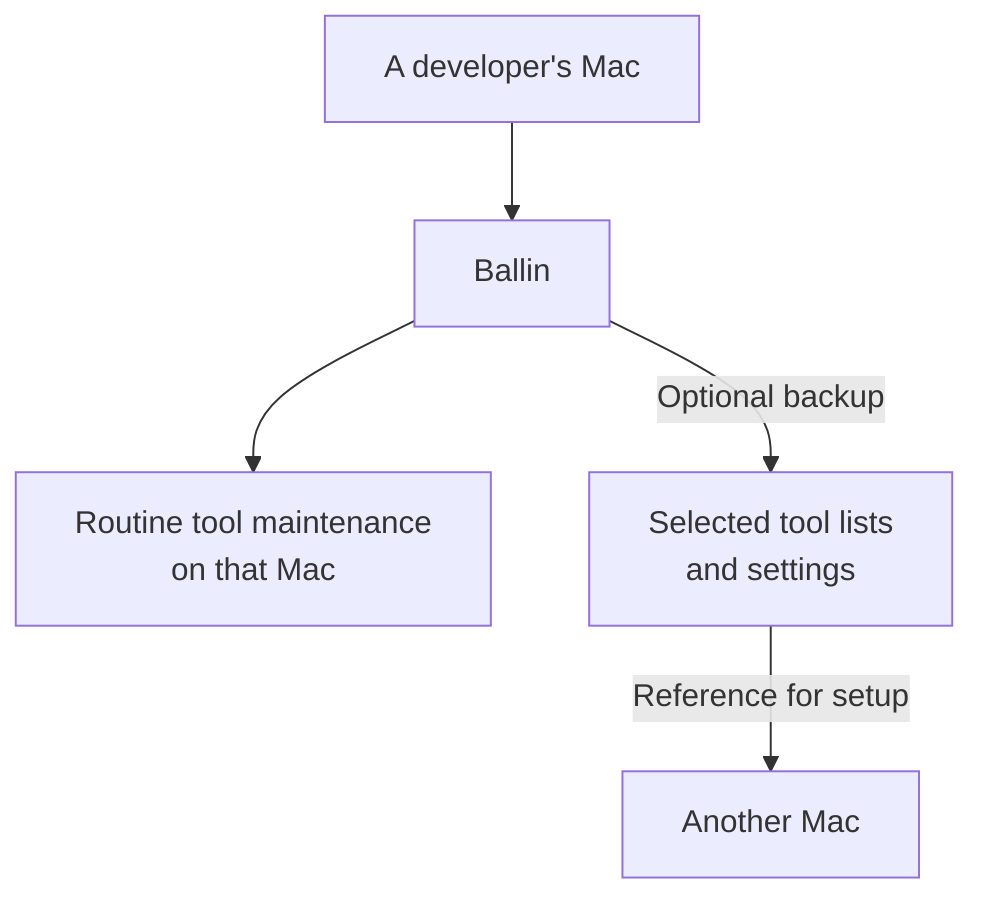

# What is Ballin?

People who build software use tools to write, test, and run their work, and
adjust settings to suit them. Ballin is a tool for their Macs that brings
routine updates together and can optionally save a record of some tool lists
and settings. That means less repetitive upkeep and less guesswork when setting
up another Mac.

Ballin grew from its creator's personal scripts for keeping a Mac's tools current
and saving its configuration. The creator wanted to share a free, open-source
tool that others could use and improve.

## Why does a developer's Mac need upkeep?

Building software takes more than the apps a person opens every day. Over time,
developers install more tools and adjust their settings. Those tools need updates,
and remembering what was installed and configured can be difficult.

## What does Ballin do?

Ballin brings routine update tasks for supported tools into one place. The tasks
that run depend on the tools available and the person's choices. For example,
with an optional helper installed, Ballin can update installed apps from the Mac
App Store. A person can use Ballin for maintenance without setting up backups.

If they choose to set up backups, Ballin can also save selected tool lists and
settings. Someone could keep their working Mac current and save a list of
installed tools. Later, when setting up another Mac, they could look at that list
and any saved settings to help decide what to install and configure. They still
carry out the setup themselves.

These optional backups are a reference for parts of a development setup, not a
backup of the whole computer. Ballin does not automatically restore a Mac.

## See it in action

See an [example run](../README.md#example-output) in the README. The
[README](../README.md) also has installation and technical details.
